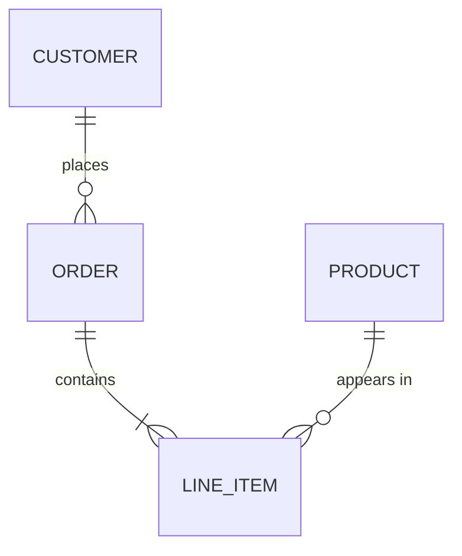

# Database Design Skill

Design schemas, write performant queries, and manage migrations for production systems.

## Workflow

```
1. Gather Requirements  →  2. Model Entities  →  3. Choose Engine
       ↓                        ↓                      ↓
4. Normalize / Denormalize  →  5. Define Schema  →  6. Add Indexes
       ↓                        ↓                      ↓
7. Write Queries  →  8. Tune (EXPLAIN)  →  9. Plan Migrations
       ↓                                       ↓
10. Set Up Backups / Replication  →  11. Deploy Safely
```

## Decision: Choosing a Database Engine

| Need | Pick | Why |
|------|------|-----|
| Complex joins, ACID, analytics | **PostgreSQL** | Rich type system, advanced indexing, JSONB |
| Simple CRUD, legacy compatibility | **MySQL** | Widespread hosting, mature tooling |
| Flexible schema, rapid iteration | **MongoDB** | Document model, horizontal scaling |
| Caching, queues, leaderboards | **Redis** | In-memory speed, rich data structures |
| Similarity search, embeddings | **pgvector** | Vector ops inside Postgres |

## Phase 1: Requirements to ER Model

1. List all **entities** (nouns) and **relationships** (verbs) from requirements.
2. Identify cardinality: 1:1, 1:N, M:N.
3. Mark required vs optional attributes.
4. Draw an ER diagram — use Mermaid `erDiagram` for inline docs.



## Phase 2: Normalization vs Denormalization

Normalize to 3NF by default. Denormalize only with measured evidence of read bottlenecks.

**When to denormalize:**
- Read-heavy dashboards with expensive joins (materialize aggregates).
- Hot-path queries where a JOIN adds >5ms latency at p99.
- Document stores where embedding avoids $lookup entirely.

**When NOT to denormalize:**
- Write-heavy tables — duplicated data means duplicated writes.
- Data that changes frequently — stale copies cause bugs.

## Phase 3: PostgreSQL Schema Design

### Types & Constraints

Use the most specific type available:

```sql
CREATE TABLE orders (
    id            UUID PRIMARY KEY DEFAULT gen_random_uuid(),
    customer_id   UUID NOT NULL REFERENCES customers(id),
    status        TEXT NOT NULL CHECK (status IN ('draft','pending','paid','cancelled')),
    total_cents   BIGINT NOT NULL CHECK (total_cents >= 0),
    currency      TEXT NOT NULL DEFAULT 'USD' CHECK (length(currency) = 3),
    metadata      JSONB NOT NULL DEFAULT '{}',
    created_at    TIMESTAMPTZ NOT NULL DEFAULT now(),
    updated_at    TIMESTAMPTZ NOT NULL DEFAULT now()
);
```

**Rules:**
- Use `UUID` for public-facing IDs, `BIGSERIAL` for internal surrogate keys.
- Use `TIMESTAMPTZ` not `TIMESTAMP` — always store time zone.
- Use `BIGINT` for money (cents), never `FLOAT` or `NUMERIC` for hot paths.
- Add `CHECK` constraints at the DB level — the DB is the last line of defense.
- Use `TEXT` over `VARCHAR(n)` unless a hard length limit is a business rule.

### Indexes

See → `references/postgres-indexing.md` for full details.

**Quick index decision tree:**
- Equality lookups → **B-tree** (default)
- JSONB `@>`, `?`, `?|` operators → **GIN**
- Geometric / range / full-text → **GiST**
- Low-cardinality filter + other index → **Partial index**
- Query needs columns only from index → **Covering index** (`INCLUDE`)

```sql
-- Partial index: only index active orders
CREATE INDEX idx_orders_active ON orders (customer_id, created_at)
    WHERE status NOT IN ('cancelled');

-- Covering index: avoid heap fetch
CREATE INDEX idx_orders_covering ON orders (customer_id)
    INCLUDE (status, total_cents);

-- GIN on JSONB
CREATE INDEX idx_orders_metadata ON orders USING gin (metadata);
```

### EXPLAIN ANALYZE

Use `EXPLAIN (ANALYZE, BUFFERS, FORMAT TEXT)` to diagnose queries. See → `references/query-tuning.md`.

```sql
EXPLAIN (ANALYZE, BUFFERS, FORMAT TEXT)
SELECT * FROM orders
WHERE customer_id = '...' AND status = 'paid'
ORDER BY created_at DESC LIMIT 20;
```

**Red flags in output:**
- `Seq Scan` on a large table when you expect Index Scan.
- `Sort` with high `Sort Method: external merge` — missing index for ORDER BY.
- `Nested Loop` with high row estimates on the inner side — consider HASH join hint or index.
- `Buffers: shared read` much larger than `shared hit` — data not cached.

### Partitioning

Partition tables exceeding ~50M rows or when you need fast bulk deletes.

```sql
CREATE TABLE events (
    id          BIGSERIAL,
    tenant_id   UUID NOT NULL,
    occurred_at TIMESTAMPTZ NOT NULL,
    payload     JSONB NOT NULL
) PARTITION BY RANGE (occurred_at);

CREATE TABLE events_2026_q1 PARTITION OF events
    FOR VALUES FROM ('2026-01-01') TO ('2026-04-01');
```

### JSONB

Use JSONB for flexible metadata, never for core relational data. Always add a GIN index.

### Full-Text Search

```sql
ALTER TABLE products ADD COLUMN search_vector tsvector
    GENERATED ALWAYS AS (
        setweight(to_tsvector('english', coalesce(name, '')), 'A') ||
        setweight(to_tsvector('english', coalesce(description, '')), 'B')
    ) STORED;

CREATE INDEX idx_products_search ON products USING gin (search_vector);

-- Query
SELECT * FROM products
WHERE search_vector @@ plainto_tsquery('english', 'wireless keyboard')
ORDER BY ts_rank(search_vector, plainto_tsquery('english', 'wireless keyboard')) DESC;
```

### Row-Level Security (RLS)

See → `references/multi-tenancy.md`.

```sql
ALTER TABLE orders ENABLE ROW LEVEL SECURITY;

CREATE POLICY tenant_isolation ON orders
    USING (tenant_id = current_setting('app.current_tenant')::UUID);
```

### Transactions & Isolation Levels

| Level | Dirty Read | Non-Repeatable | Phantom | Use Case |
|-------|-----------|----------------|---------|----------|
| READ COMMITTED (PG default) | No | Yes | Yes | General OLTP |
| REPEATABLE READ | No | No | No* | Balance checks, reports |
| SERIALIZABLE | No | No | No | Financial ledgers |

*Postgres REPEATABLE READ also prevents phantoms (snapshot isolation).

```sql
BEGIN ISOLATION LEVEL SERIALIZABLE;
-- critical financial operation
COMMIT;
```

### Locking & Deadlocks

- Use `SELECT ... FOR UPDATE` to lock rows you intend to modify.
- Access tables in a consistent order to prevent deadlocks.
- Keep transactions short — acquire locks late, release early.
- Set `lock_timeout` and `statement_timeout` to bound wait times.

## Phase 4: MySQL Differences

- Default engine: InnoDB (use it). MyISAM lacks transactions.
- `utf8mb4` not `utf8` — MySQL's `utf8` is only 3 bytes.
- No partial indexes — use generated columns + index as workaround.
- No transactional DDL — migrations cannot be rolled back atomically.
- `ENUM` type is native (Postgres uses `CHECK` or custom types).
- `EXPLAIN FORMAT=JSON` or `EXPLAIN ANALYZE` (MySQL 8.0.18+).

## Phase 5: MongoDB Modeling

See → `references/mongodb-modeling.md`.

**Embed when:** data is read together, 1:few, child doesn't exist independently.
**Reference when:** M:N, child is large, child is shared across parents.

## Phase 6: Redis Patterns

See → `references/redis-patterns.md`.

Common patterns: cache-aside, write-through, session store, rate limiter (sliding window), leaderboards (sorted sets), pub/sub for events.

## Phase 7: Vector Databases (pgvector)

```sql
CREATE EXTENSION IF NOT EXISTS vector;

CREATE TABLE embeddings (
    id      BIGSERIAL PRIMARY KEY,
    content TEXT NOT NULL,
    vec     vector(1536) NOT NULL   -- OpenAI ada-002 dimensions
);

CREATE INDEX idx_embeddings_vec ON embeddings
    USING ivfflat (vec vector_cosine_ops) WITH (lists = 100);

-- Nearest-neighbor query
SELECT id, content, vec <=> '[...]'::vector AS distance
FROM embeddings
ORDER BY vec <=> '[...]'::vector
LIMIT 10;
```

## Phase 8: ORM Usage & Pitfalls

### N+1 Query Problem

```python
# BAD — N+1 with SQLAlchemy
users = session.query(User).all()
for user in users:
    print(user.orders)   # each triggers a SELECT

# GOOD — eager load
users = session.query(User).options(joinedload(User.orders)).all()
```

```typescript
// BAD — N+1 with Prisma
const users = await prisma.user.findMany();
for (const u of users) {
  const orders = await prisma.order.findMany({ where: { userId: u.id } });
}

// GOOD — include
const users = await prisma.user.findMany({ include: { orders: true } });
```

**ORM rules:**
- Always check generated SQL (`DEBUG` logging or Prisma query events).
- Use raw SQL for complex analytics — ORMs generate suboptimal plans.
- Batch inserts with `insertMany` / `bulk_save_objects`.
- Use connection pooling (PgBouncer or built-in pool) — ORMs open many connections.

## Phase 9: Zero-Downtime Migrations

See → `references/migration-safety.md`.

**Golden rules:**
1. Never rename or drop a column in a single deploy — use expand/contract.
2. Add columns as `NULL` first, backfill, then add `NOT NULL` constraint.
3. Create indexes `CONCURRENTLY` on Postgres to avoid table locks.
4. Use advisory locks or migration tools that serialize deploys.
5. Test migration on a production-size copy before running in prod.

## Phase 10: Multi-Tenancy

See → `references/multi-tenancy.md`.

| Pattern | Isolation | Complexity | Cost |
|---------|-----------|------------|------|
| Shared table + `tenant_id` | Low | Low | Low |
| Schema per tenant | Medium | Medium | Medium |
| Database per tenant | High | High | High |

## Phase 11: Common Patterns

### Soft Delete

```sql
ALTER TABLE orders ADD COLUMN deleted_at TIMESTAMPTZ;
CREATE INDEX idx_orders_not_deleted ON orders (id) WHERE deleted_at IS NULL;
-- Always filter: WHERE deleted_at IS NULL
```

### Audit Log

See → `assets/audit_table.sql` for a complete template.

### Time-Series

- Use partitioning by time range.
- Consider TimescaleDB extension for automatic chunk management.
- Aggregate into rollup tables for dashboards.

## Phase 12: Backup, Restore & PITR

- Use `pg_basebackup` for physical backups + WAL archiving for PITR.
- Use `pg_dump` / `pg_restore` for logical backups (smaller datasets).
- Test restores regularly — an untested backup is not a backup.
- For RDS/Cloud SQL, use managed snapshots + PITR configuration.

## Phase 13: Replication & Connection Pooling

- Streaming replication for read replicas.
- Route read queries to replicas, writes to primary.
- Use PgBouncer in `transaction` mode for connection pooling.
- Set `pool_size` to `(2 * CPU cores) + disk spindles` as a starting point.

## Examples

### Example 1: E-commerce Product Catalog

**Input:** "Design a schema for a product catalog with variants, pricing, and categories."

**Output:**
```sql
CREATE TABLE categories (
    id          UUID PRIMARY KEY DEFAULT gen_random_uuid(),
    parent_id   UUID REFERENCES categories(id),
    name        TEXT NOT NULL,
    slug        TEXT NOT NULL UNIQUE
);

CREATE TABLE products (
    id            UUID PRIMARY KEY DEFAULT gen_random_uuid(),
    category_id   UUID NOT NULL REFERENCES categories(id),
    name          TEXT NOT NULL,
    description   TEXT,
    is_active     BOOLEAN NOT NULL DEFAULT true,
    created_at    TIMESTAMPTZ NOT NULL DEFAULT now()
);

CREATE TABLE product_variants (
    id            UUID PRIMARY KEY DEFAULT gen_random_uuid(),
    product_id    UUID NOT NULL REFERENCES products(id),
    sku           TEXT NOT NULL UNIQUE,
    price_cents   BIGINT NOT NULL CHECK (price_cents >= 0),
    attributes    JSONB NOT NULL DEFAULT '{}',
    stock_count   INT NOT NULL DEFAULT 0 CHECK (stock_count >= 0)
);

CREATE INDEX idx_variants_product ON product_variants (product_id);
CREATE INDEX idx_variants_attrs ON product_variants USING gin (attributes);
```

### Example 2: Fixing a Slow Query

**Input:** "This query takes 12 seconds: `SELECT * FROM events WHERE payload->>'type' = 'click' AND created_at > now() - interval '7 days' ORDER BY created_at DESC LIMIT 100;`"

**Output:**
```sql
-- Step 1: Add a targeted index
CREATE INDEX CONCURRENTLY idx_events_type_created
    ON events ((payload->>'type'), created_at DESC)
    WHERE payload->>'type' IS NOT NULL;

-- Step 2: Rewrite to use the index
SELECT id, payload, created_at
FROM events
WHERE payload->>'type' = 'click'
  AND created_at > now() - interval '7 days'
ORDER BY created_at DESC
LIMIT 100;

-- Step 3: Verify with EXPLAIN ANALYZE
EXPLAIN (ANALYZE, BUFFERS) ...;
-- Expect: Index Scan Backward, <10ms execution
```

### Example 3: Safe Migration

**Input:** "Add a required `email` column to the `accounts` table (50M rows)."

**Output (expand/contract):**
```sql
-- Deploy 1: Add nullable column
ALTER TABLE accounts ADD COLUMN email TEXT;

-- Deploy 2: Backfill in batches (see migration_safety_check.py)
UPDATE accounts SET email = default_email_from_users(id)
WHERE id BETWEEN $1 AND $2;

-- Deploy 3: Add constraint without full lock (Postgres 12+)
ALTER TABLE accounts ADD CONSTRAINT accounts_email_not_null
    CHECK (email IS NOT NULL) NOT VALID;
ALTER TABLE accounts VALIDATE CONSTRAINT accounts_email_not_null;

-- Deploy 4: Convert to true NOT NULL (optional, instant in PG 12+)
ALTER TABLE accounts ALTER COLUMN email SET NOT NULL;
ALTER TABLE accounts DROP CONSTRAINT accounts_email_not_null;
```

## Reference Index

| Topic | File |
|-------|------|
| B-tree, GIN, GiST, partial, covering indexes | `references/postgres-indexing.md` |
| EXPLAIN ANALYZE interpretation, common fixes | `references/query-tuning.md` |
| Zero-downtime migration strategies | `references/migration-safety.md` |
| Multi-tenancy patterns and RLS | `references/multi-tenancy.md` |
| MongoDB document modeling | `references/mongodb-modeling.md` |
| Redis caching and data-structure patterns | `references/redis-patterns.md` |
| Pre-review schema checklist | `references/schema-review-checklist.md` |

## Scripts

| Script | Purpose |
|--------|---------|
| `scripts/explain_analyzer.py` | Parse EXPLAIN ANALYZE output, flag problems |
| `scripts/schema_lint.py` | Lint SQL schema for common mistakes |
| `scripts/migration_safety_check.py` | Validate migration SQL for safety |

## Assets

| Asset | Purpose |
|-------|---------|
| `assets/audit_table.sql` | Audit log table + trigger template |
| `assets/tenant_tables.sql` | Multi-tenant base schema template |
| `assets/docker-compose.yml` | Postgres + Redis dev environment |
