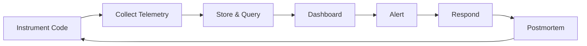

# Observability & SRE Skill

Make failures **visible** before users notice them and **recoverable** before they
cascade. This skill guides end-to-end instrumentation: from emitting structured
telemetry, through aggregation and dashboards, to actionable alerts and rehearsed
incident response.

## Three Pillars of Observability

| Pillar  | Purpose                        | Primary Tools              |
|---------|--------------------------------|----------------------------|
| Logs    | Discrete events, debug context | Loki, structured JSON logs |
| Metrics | Aggregated numeric time-series | Prometheus, Grafana        |
| Traces  | Request-scoped causal chains   | OpenTelemetry, Jaeger      |

Use all three together — correlation IDs tie a single request across pillars.

## Quick-Start Workflow



1. **Instrument** — Add OTel SDK, structured logging, and health endpoints.
   See `references/otel-setup.md`.
2. **Collect** — Deploy OTel Collector, Prometheus, and Loki.
   See `references/prometheus-grafana.md`.
3. **Define SLOs** — Pick SLIs, set targets, compute error budgets.
   See `references/slo-guide.md`.
4. **Alert** — Write symptom-based, low-noise alert rules.
   See `references/alerting-rules.md`.
5. **Build Dashboards** — Use RED (Request rate, Error rate, Duration) for services
   and USE (Utilization, Saturation, Errors) for resources.
   Run `scripts/gen_dashboard_json.py` to scaffold Grafana JSON.
6. **Prepare Runbooks** — One per alert, stored alongside the alert definition.
   See `references/runbook-template.md`.
7. **Practice Incidents** — Chaos tests, game days, postmortem reviews.
   See `references/postmortem-template.md`.

## Structured Logging

Emit JSON logs with a consistent schema. Every log line must contain:

| Field            | Example                              | Why                             |
|------------------|--------------------------------------|---------------------------------|
| `timestamp`      | `2025-06-15T08:22:01.332Z`          | Ordering and correlation        |
| `level`          | `info`, `warn`, `error`             | Filtering                       |
| `service`        | `checkout-api`                       | Multi-service disambiguation    |
| `trace_id`       | `abc123def456`                       | Cross-pillar correlation        |
| `span_id`        | `78ef90`                             | Pinpoint exact operation        |
| `message`        | `Payment processed`                  | Human-readable event            |
| `error.type`     | `TimeoutError`                       | Error classification            |

### Python Example (structlog)

```python
import structlog

structlog.configure(
    processors=[
        structlog.processors.TimeStamper(fmt="iso"),
        structlog.processors.JSONRenderer(),
    ]
)
log = structlog.get_logger()
log.info("order.created", order_id="ORD-9981", amount=49.99)
```

Output:

```json
{"timestamp":"2025-06-15T08:22:01.332Z","level":"info","event":"order.created","order_id":"ORD-9981","amount":49.99}
```

## OpenTelemetry Instrumentation (Summary)

Refer to `references/otel-setup.md` for full setup. High-level steps:

1. Install SDK: `pip install opentelemetry-api opentelemetry-sdk opentelemetry-exporter-otlp`
2. Auto-instrument frameworks: `opentelemetry-instrument --service_name my-svc python app.py`
3. Add manual spans for business logic (e.g., payment processing).
4. Export to OTel Collector, then fan out to Jaeger (traces), Prometheus (metrics), Loki (logs).

### FastAPI Minimal Example

```python
from opentelemetry import trace
from opentelemetry.instrumentation.fastapi import FastAPIInstrumentor
from fastapi import FastAPI

app = FastAPI()
FastAPIInstrumentor.instrument_app(app)
tracer = trace.get_tracer(__name__)

@app.get("/healthz")
def healthz():
    return {"status": "ok"}

@app.post("/checkout")
def checkout(order: dict):
    with tracer.start_as_current_span("process_payment"):
        # ... payment logic
        return {"status": "confirmed"}
```

## SLI / SLO / Error Budgets (Summary)

Refer to `references/slo-guide.md` for detailed guidance.

| Concept       | Definition                                                      | Example                           |
|---------------|-----------------------------------------------------------------|-----------------------------------|
| SLI           | Quantitative measure of service health                          | Fraction of requests under 300ms  |
| SLO           | Target value for an SLI over a window                           | 99.9% of requests under 300ms/30d |
| Error Budget  | 1 − SLO; amount of allowed unreliability                       | 0.1% = ~43 min/month              |

Decision rule: when the error budget is exhausted, freeze feature releases and
focus on reliability work.

## Alert Design Principles

Refer to `references/alerting-rules.md` for rule templates.

1. **Alert on symptoms, not causes.** Users care that checkout is slow, not that
   CPU is at 80%.
2. **Multi-window, multi-burn-rate.** Use 1h/6h windows at 14x/6x burn rates to
   catch fast and slow burns.
3. **Every alert needs a runbook.** No runbook → no page.
4. **Route by severity.** `critical` → page on-call; `warning` → ticket next
   business day.

## Dashboard Design

### RED Method (Services)

- **R**ate — requests per second (`rate(http_requests_total[5m])`)
- **E**rror rate — errors / total (`rate(http_errors_total[5m]) / rate(http_requests_total[5m])`)
- **D**uration — latency percentiles (`histogram_quantile(0.99, ...)`)

### USE Method (Resources)

- **U**tilization — proportion busy (`avg(node_cpu_seconds_total{mode!="idle"})`)
- **S**aturation — queue depth, waiting threads
- **E**rrors — hardware/driver errors

Run `scripts/gen_dashboard_json.py` to generate a starter Grafana dashboard JSON
for a given service name. See the script's `--help` for options.

## Health Checks and Graceful Degradation

Expose two endpoints:

| Endpoint    | Purpose                                              |
|-------------|------------------------------------------------------|
| `/healthz`  | Liveness — is the process alive? (k8s liveness probe)|
| `/readyz`   | Readiness — can it serve traffic? (dependency checks)|

Implement circuit breakers around non-critical dependencies. When a dependency is
down, degrade gracefully (serve cached data, disable feature) rather than failing
the whole request.

```python
# Readiness check example
@app.get("/readyz")
async def readyz():
    db_ok = await check_db()
    cache_ok = await check_cache()
    if not db_ok:
        return JSONResponse({"db": "down"}, status_code=503)
    return {"db": "ok", "cache": "ok" if cache_ok else "degraded"}
```

## Incident Process

1. **Detect** — Alert fires or customer reports issue.
2. **Triage** — On-call acknowledges within SLA (e.g., 5 min for P1).
3. **Mitigate** — Restore service first; root-cause later.
4. **Communicate** — Status page update every 15 min.
5. **Resolve** — Confirm SLIs are healthy.
6. **Postmortem** — Within 48 hours; blameless, action-item driven.
   See `references/postmortem-template.md`.

## Chaos Testing Basics

Start small and increase blast radius:

| Level | Technique                     | Tool                  |
|-------|-------------------------------|-----------------------|
| 1     | Kill a single pod             | `kubectl delete pod`  |
| 2     | Inject network latency        | Chaos Mesh, Toxiproxy |
| 3     | Fail an entire AZ             | AWS FIS, Litmus       |
| 4     | Dependency outage simulation  | Toxiproxy, Gremlin    |

Prerequisite: observability is in place and you have runbooks for expected
failure modes. Run chaos experiments in staging first.

## Backup & Restore Drills

- Schedule quarterly restore drills for every stateful service.
- Measure RTO (Recovery Time Objective) and RPO (Recovery Point Objective).
- Automate backup verification: restore to a scratch environment and run smoke
  tests nightly.

## Local Observability Stack

Use `scripts/docker-compose.yml` to spin up Prometheus, Grafana, Loki, and an
OTel Collector locally:

```bash
cd scripts/
docker compose up -d
```

Grafana is at `http://localhost:3000` (admin/admin). Prometheus at `:9090`.

## Example: End-to-End Instrumented FastAPI Service

```python
# app.py — full working example
import logging, structlog, uvicorn
from fastapi import FastAPI, Request
from opentelemetry import trace, metrics
from opentelemetry.sdk.trace import TracerProvider
from opentelemetry.sdk.metrics import MeterProvider
from opentelemetry.sdk.trace.export import BatchSpanProcessor
from opentelemetry.exporter.otlp.proto.grpc.trace_exporter import OTLPSpanExporter
from opentelemetry.instrumentation.fastapi import FastAPIInstrumentor
from prometheus_client import Counter, Histogram, generate_latest, CONTENT_TYPE_LATEST
from starlette.responses import Response

app = FastAPI(title="checkout-api")

# --- Metrics ---
REQUEST_COUNT = Counter("http_requests_total", "Total requests", ["method", "endpoint", "status"])
REQUEST_LATENCY = Histogram("http_request_duration_seconds", "Latency", ["endpoint"])

# --- Tracing ---
provider = TracerProvider()
provider.add_span_processor(BatchSpanProcessor(OTLPSpanExporter()))
trace.set_tracer_provider(provider)
FastAPIInstrumentor.instrument_app(app)
tracer = trace.get_tracer(__name__)

# --- Structured Logging ---
structlog.configure(processors=[
    structlog.processors.TimeStamper(fmt="iso"),
    structlog.processors.JSONRenderer(),
])
log = structlog.get_logger()

@app.middleware("http")
async def metrics_middleware(request: Request, call_next):
    import time
    start = time.perf_counter()
    response = await call_next(request)
    duration = time.perf_counter() - start
    REQUEST_COUNT.labels(request.method, request.url.path, response.status_code).inc()
    REQUEST_LATENCY.labels(request.url.path).observe(duration)
    return response

@app.get("/healthz")
def healthz():
    return {"status": "ok"}

@app.get("/metrics")
def metrics_endpoint():
    return Response(content=generate_latest(), media_type=CONTENT_TYPE_LATEST)

@app.post("/checkout")
def checkout(order: dict):
    with tracer.start_as_current_span("validate_order"):
        log.info("checkout.started", order_id=order.get("id"))
    with tracer.start_as_current_span("process_payment"):
        log.info("payment.processed", order_id=order.get("id"))
    return {"status": "confirmed", "order_id": order.get("id")}

if __name__ == "__main__":
    uvicorn.run(app, host="0.0.0.0", port=8000)
```

## Example: SLO-Based Alerting Rule (Prometheus)

```yaml
groups:
  - name: checkout-slo
    rules:
      - alert: CheckoutHighErrorRate
        expr: |
          (
            sum(rate(http_requests_total{service="checkout",status=~"5.."}[1h]))
            /
            sum(rate(http_requests_total{service="checkout"}[1h]))
          ) > 14 * 0.001
        for: 2m
        labels:
          severity: critical
        annotations:
          summary: "Checkout error rate burning 14x the error budget (1h window)"
          runbook_url: "https://wiki.internal/runbooks/checkout-high-error-rate"
```

## File Index

| Path                                | Purpose                               |
|-------------------------------------|---------------------------------------|
| `references/otel-setup.md`         | OTel SDK, Collector, and exporter setup|
| `references/prometheus-grafana.md` | Prometheus config, PromQL, Grafana     |
| `references/slo-guide.md`         | SLI/SLO/error budget methodology       |
| `references/alerting-rules.md`    | Alert rule templates and design        |
| `references/runbook-template.md`  | On-call runbook scaffold               |
| `references/postmortem-template.md`| Blameless postmortem template          |
| `scripts/gen_dashboard_json.py`   | Generate Grafana dashboard JSON        |
| `scripts/alert_rule_lint.sh`      | Lint Prometheus alerting rules         |
| `scripts/docker-compose.yml`      | Local observability stack              |
